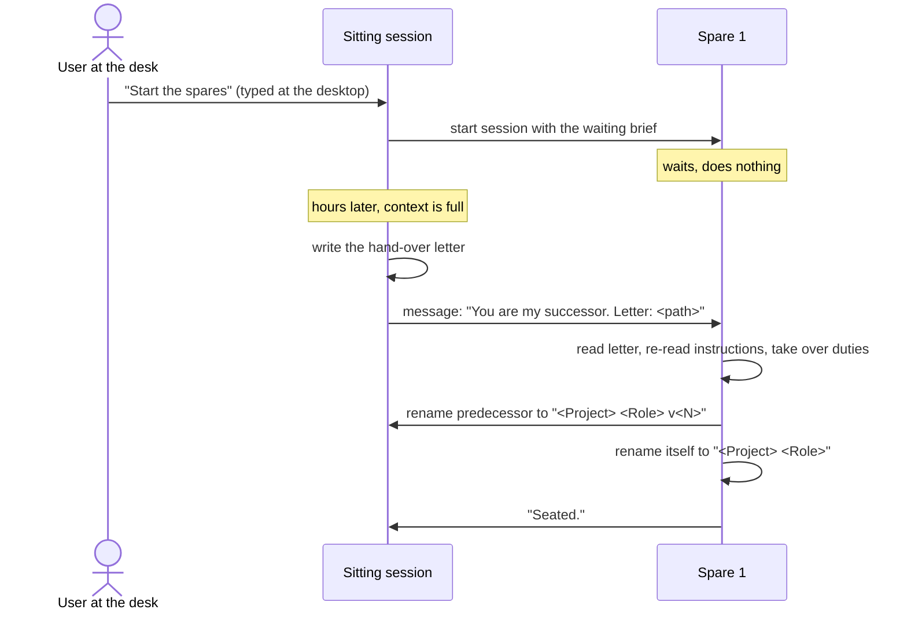

# Spares: unattended hand-over for long-running Claude Code sessions

A technique for people who run long-lived coordinating sessions in the Code tab of the Claude desktop app, and need those sessions to hand over to a fresh session while nobody is at the desk.

## The problem

A long-running coordinating session fills its context window in hours. The clean fix is a hand-over. The session writes a hand-over letter, and a fresh session continues from it.

The desktop app lets a session start another session only on a message the user typed at the desktop. So every hand-over waits for a person. If you are away, the work stops until you come back. At night that costs hours.

## The idea

Start the successors before you need them.

While you are at the desk, the sitting session starts several successor sessions in advance, on one sentence you type. These are the spares. They wait and do nothing.

When the sitting session is full, it writes its letter and wakes the first unused spare with an ordinary session-to-session message. No session needs to be started at hand-over time, so no person is needed.

Your only recurring step is one sentence at the desk, for example each evening: "Top up the spares."

## What you get

- Hand-overs that run at any hour without a person.
- Each successor starts with a clean context window, not a summary.
- A waiting spare costs almost nothing. It does nothing after its first short turn.
- If the spares run out, behaviour is exactly as before: the session asks you to start a new one.

## What it does not solve

- How often a session fills. That depends on your work.
- A crashed or stuck session. You recover that by hand.
- You still need to be at the desk once per top-up.
- Any change Anthropic makes to these app rules. If the rules change, the technique may stop working.

## Install

AI coding agents: read [INSTALL.md](INSTALL.md) and follow it. People: point your coding agent at this repository.

More: [how it works](docs/how-it-works.md), [what was tested](docs/what-was-tested.md), [alternatives](docs/alternatives.md), [templates](templates/).

## Tested on

The Claude desktop app on macOS, 10 November 2026. Hand-overs to waiting spares also worked on Windows by user report. That was not independently checked.

## Note

Unofficial and not affiliated with Anthropic. It describes app behaviour observed on one date, which can change without notice. MIT licence, see [LICENSE](LICENSE).
